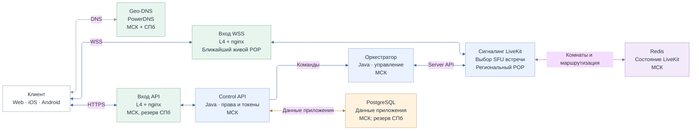
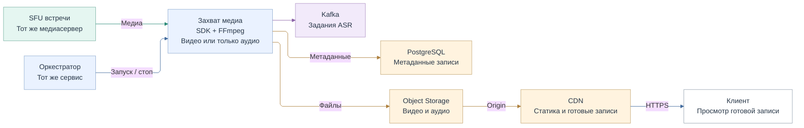
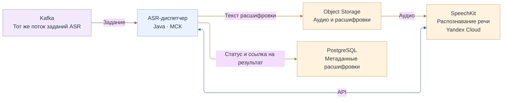

# Исходный код диаграммы: Схема проекта (раздел 10)

Четыре сценария показаны отдельно. Повторённые Kafka, Redis, PostgreSQL, Object Storage, клиент и SFU обозначают те же компоненты.

PNG и SVG с фиксированным расположением блоков собираются из единого описания:

```bash
python3 scripts/render_project_scheme.py
```

Нужны Python 3, Node.js и Chromium-браузер. Путь к браузеру можно передать через `--browser`. Сетевые запросы для сборки не нужны.

## 01   ПОДКЛЮЧЕНИЕ И УПРАВЛЕНИЕ



## 02   МЕДИАПУТЬ И КАЧЕСТВО ЗВОНКА

```mermaid
%%{init: {"theme":"base", "layout":"elk", "look":"classic", "flowchart":{"curve":"linear"}}}%%
flowchart LR
    C2["Клиент<br/>Тот же участник"]:::client
    SIG2["Сигналинг LiveKit<br/>Согласование соединения"]:::service
    SFU2["SFU встречи<br/>LiveKit · один узел на встречу<br/>POP размещения встречи"]:::media
    RD2["Redis<br/>Загрузка и состояние узлов"]:::queue
    TURN2["TURN<br/>coturn · региональный POP"]:::edge
    KF2["Kafka<br/>События качества"]:::queue
    CH2["ClickHouse<br/>Аналитика качества звонков"]:::store

    C2 <-->|"SRTP / UDP напрямую"| SFU2
    SIG2 <--> SFU2
    SFU2 <-->|"Состояние"| RD2
    C2 <-.->|"Если прямой путь недоступен"| TURN2
    TURN2 <-->|"Relay"| SFU2
    SFU2 -->|"QoS через сборщик"| KF2
    KF2 -->|"QoS"| CH2

    classDef client fill:#ffffff,stroke:#9aa6b2,color:#273647
    classDef edge fill:#e8f5ef,stroke:#89b4a0,color:#273647
    classDef service fill:#eaf2ff,stroke:#94afd2,color:#273647
    classDef media fill:#e5f6f1,stroke:#7eb4a7,color:#273647
    classDef store fill:#fff3df,stroke:#c6aa79,color:#273647
    classDef queue fill:#f2eafa,stroke:#b397c8,color:#273647
    linkStyle 0 stroke:#288976
    linkStyle 1 stroke:#426b9e
    linkStyle 2 stroke:#8c63a8
    linkStyle 3 stroke:#288976
    linkStyle 4 stroke:#288976
    linkStyle 5 stroke:#8c63a8
    linkStyle 6 stroke:#8c63a8
```



## 03   ЗАПИСЬ И ВЫДАЧА ФАЙЛОВ



## 04   РАСШИФРОВКА


